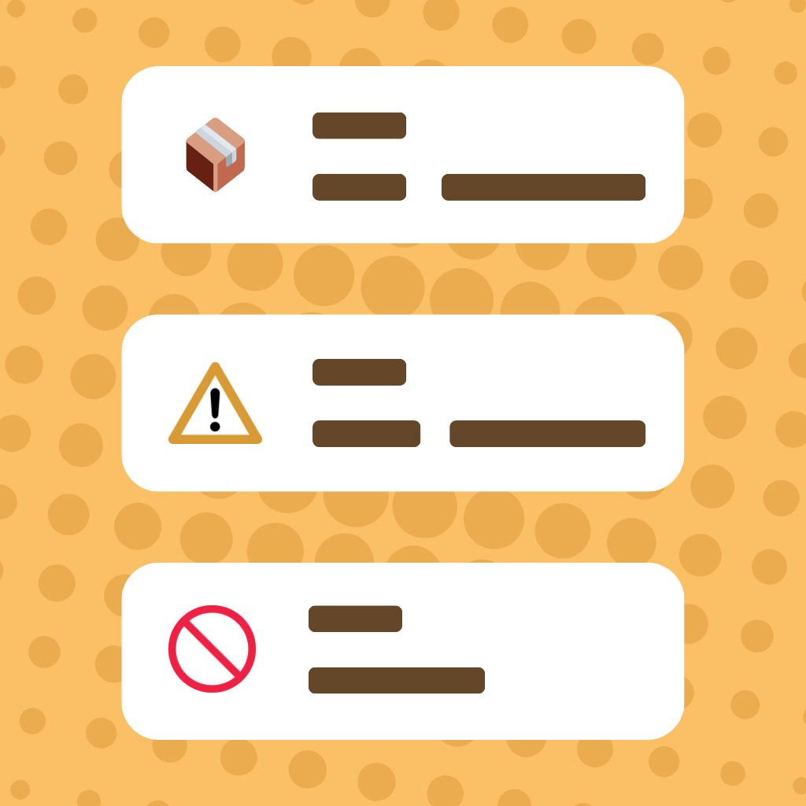

# CookFetch

A smart kitchen and household management app that helps people reduce food waste, track expiry dates, discover recipes, and stay organized with groceries and meal planning.

**Live demo:** https://cookfetch.kaamaru.com/


## Overview

CookFetch is built around everyday kitchen workflows: what's in the fridge, what needs to be used soon, what to cook next, and how to plan shopping without waste.

## Features

- Food inventory tracking with an expiration and freshness dashboard
- Smart reminders and notifications before food goes bad
- Recipe search and recommendations based on available ingredients
- AI kitchen assistant for cooking ideas and meal planning
- Grocery list and shopping task management
- Household sharing for multi-user planning
- Schedule management for household tasks and meals
- Barcode/scan-based food handling support
- Responsive UI for desktop and mobile

## Screenshots

| Dashboard | Kitchen Assistant | Shopping List |
|-----------|-------------------|---------------|
|  |  |  |

## Tech Stack

| Area | Tools |
|------|-------|
| Framework | Next.js, React, TypeScript |
| Styling / UI | Tailwind CSS, shadcn/ui, Radix UI |
| Forms & validation | React Hook Form, Zod |
| Backend services | Firebase Authentication, Firestore |
| Deployment | Vercel |

## Project Structure

```text
.
├── app/                  # App routes and page entry points
├── src/
│   ├── components/       # Reusable UI and feature components
│   ├── contexts/         # Auth, language, and app state contexts
│   ├── hooks/            # Custom hooks
│   ├── lib/              # Config, API helpers, Firebase setup, utilities
│   ├── types/            # Shared TypeScript types
│   ├── data/             # Static dictionaries and JSON data
│   └── _pages_backup/    # Older page implementations
├── public/
│   └── media/            # Screenshots and app imagery
├── doc/                  # Feature and integration documentation
├── package.json
├── next.config.ts
├── tailwind.config.ts
└── tsconfig.json
```

## Getting Started

### Prerequisites

- Node.js 18+
- npm

### Install

```bash
git clone https://github.com/Kaamaru/CookFetch-Deploy.git
cd CookFetch-Deploy
npm install
```

### Run locally

```bash
npm run dev
```

The dev server runs at http://localhost:8888.

### Scripts

| Command | Description |
|---------|-------------|
| `npm run dev` | Start the development server |
| `npm run build` | Create a production build |
| `npm run start` | Run the production server |
| `npm run lint` | Run lint checks |

## Environment Variables

Create a `.env.local` file in the project root:

```env
# Optional: falls back to /api/proxy if not set
NEXT_PUBLIC_API_BASE_URL=

NEXT_PUBLIC_FIREBASE_API_KEY=
NEXT_PUBLIC_FIREBASE_AUTH_DOMAIN=
NEXT_PUBLIC_FIREBASE_DATABASE_URL=
NEXT_PUBLIC_FIREBASE_PROJECT_ID=
NEXT_PUBLIC_FIREBASE_STORAGE_BUCKET=
NEXT_PUBLIC_FIREBASE_MESSAGING_SENDER_ID=
NEXT_PUBLIC_FIREBASE_APP_ID=
NEXT_PUBLIC_FIREBASE_MEASUREMENT_ID=
```

> **Heads up:** Firebase config is currently hardcoded in `src/lib/firebase.ts`. Before making the repo public, move those values into the environment variables above and rotate the existing keys. Keep `.env*` files out of version control.

## Deployment

The app is ready to deploy on Vercel or any Next.js host:

1. Set the environment variables in your hosting platform.
2. Point `NEXT_PUBLIC_API_BASE_URL` at your production API.
3. Verify auth, recipe, grocery, and household flows in the deployed environment.
